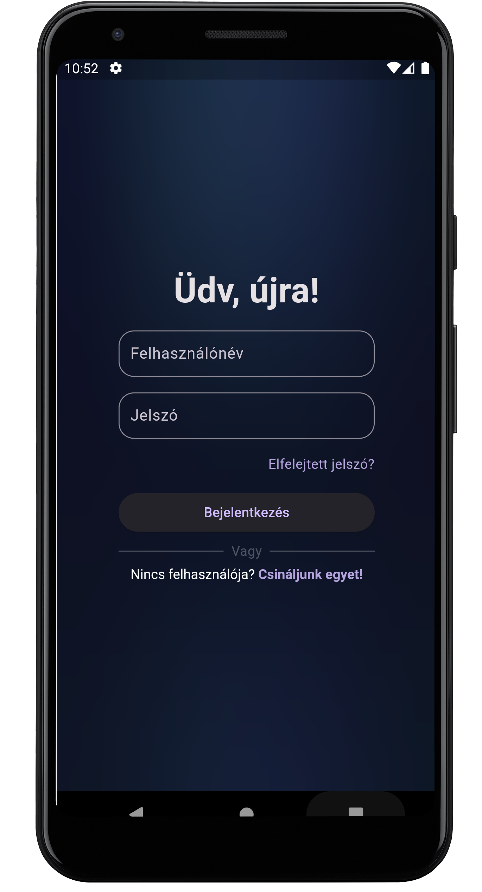
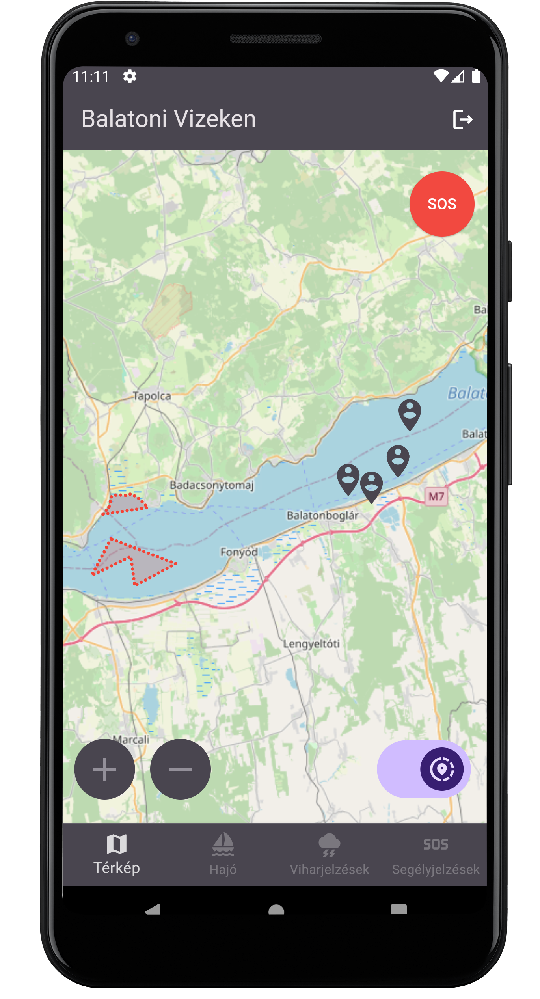
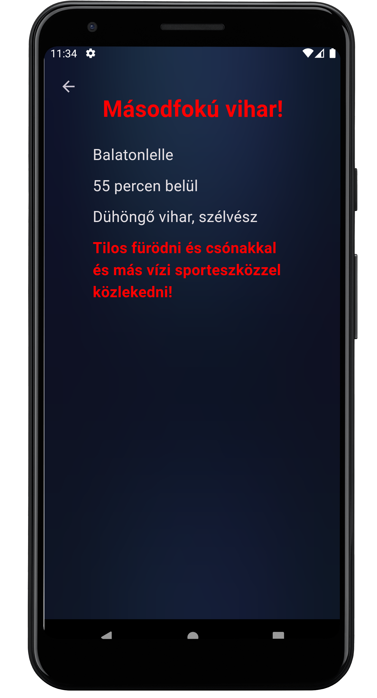
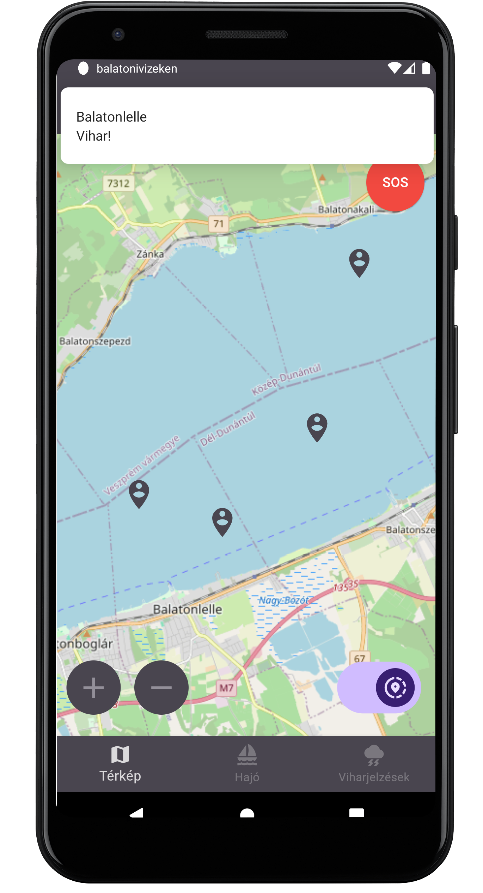

# balatonivizeken_normal

#### My MSc thesis project.

Continued the already existing balatonivizeken app, which is a virtual radar for small ships. 
<b>What was already done:</b> authenticated users could see the regularly-updated positions of their and others' ships, and modify ship data. 
<b>What I made:</b> I added new features to the original app and created partly new apps: one for officials and another for lifeguards. New features include a storm alert system (alerts can be created in the official's app and notifications are sent to the other apps), an SOS system (anyone can send and lifeguards receive them) and "no-go zone" feature (these can also be created in the official's app on a polygon drawer screen). The official's app main target is web, so it also features responsive and adaptive UI. 
The project uses Flutter for frontend, NestJS for backend, MongoDB for database, JWT for authentication and Server Sent Events for sending out alerts.

#### This the repository for the "normal" client app

needs atleast Flutter version 3.7.2

Project uses fvm

flutter packages pub run build_runner build --delete-conflicting-outputs

&emsp;&emsp;&emsp;&emsp; 
 

